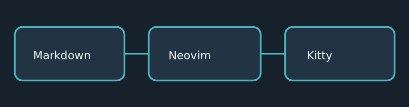

# Markdown and inline images

Open this file in **Neovim running inside Kitty**.

## Local image

The diagram below uses a path relative to this Markdown file. It should appear
inline after Snacks is installed and the Markdown parsers are available.

## Rich Markdown

- [x] Existing Markdown styling
- [x] Browser preview remains available
- [ ] Confirm the diagram appears inline in Kitty

| Feature | Provided by |
| --- | --- |
| Styled headings and lists | render-markdown.nvim |
| Wrapped table cells | markdown-table-wrap.nvim |
| Inline local images | Snacks.image and Kitty |
| Browser preview | markdown-preview.nvim |

> In normal mode, `Space m p` toggles browser preview and `Space m s` stops it.
> Inline images appear automatically; neither shortcut is needed for them.

If the diagram does not appear, run `:checkhealth snacks` and inspect the image
section. Start with Kitty directly, without tmux or SSH, to keep the test simple.

